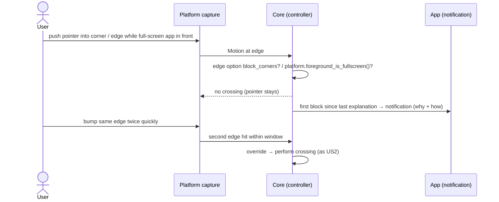
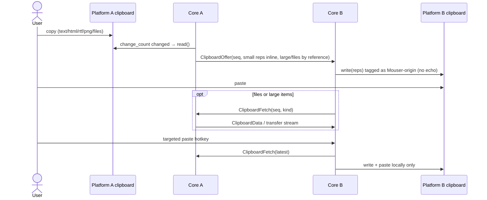
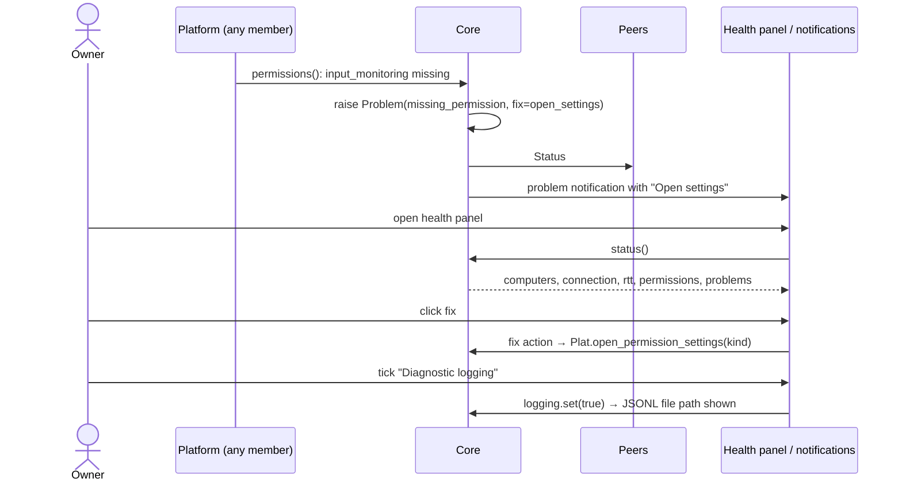
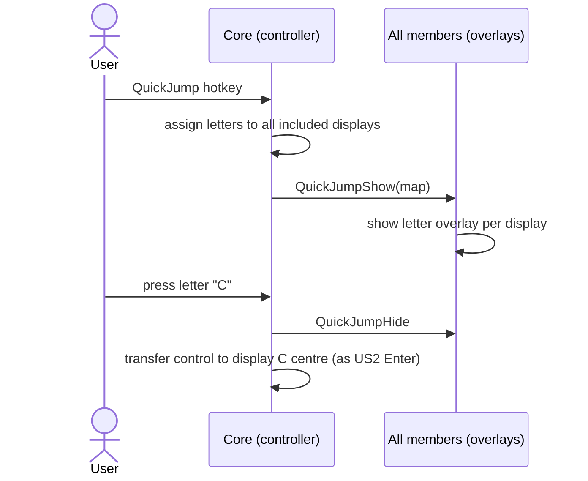

# Implementation Plan: Mouser v1

**Branch**: `001-mouser-v1` | **Date**: 2026-10-21 | **Spec**: [spec.md](spec.md)

**Input**: Feature specification from `specs/001-mouser-v1/spec.md`

## Summary

Mouser v1 delivers all 13 stories of the spec: computers join a named desk (one-click approval), one mouse and keyboard cross display edges between macOS, Windows and Linux computers, the connection heals itself through sleep, network and VPN changes, and clipboard, file drag, display arrangement, health/diagnostics, CLI, LAN-distributed updates, QuickJump, login-screen control and portable mode follow. Technical approach (research.md): a platform-neutral Rust engine (`mouser-core`) speaking QUIC (quinn) with mDNS discovery restricted to physical LAN interfaces; per-OS input/clipboard backends behind one frozen trait (`mouser-platform`); a Tauri tray app hosting the engine; a CLI over a local JSON-RPC socket; a Windows SYSTEM service for secure-desktop control.

## Technical Context

**Language/Version**: Rust 1.99 (edition 2024); UI in static HTML + ES modules served by Tauri

**Primary Dependencies**: quinn 0.11.12, rustls 0.23, rcgen 0.14.10, tokio 1.54, mdns-sd 0.21.6, if-addrs 0.15.0, postcard + serde, ed25519-dalek, tauri 2.12.5 (+ single-instance 2.5.4, autostart 2.7.0, updater 2.14.0), clipboard-rs 0.3.5 (macOS), core-graphics 0.25 / objc2 (macOS), windows 0.62.2 (Windows), x11rb 0.14.0, ashpd 0.13.13, reis 0.7.1 (Linux), notify (config watch), tracing + JSONL writer, clap (CLI)

**Storage**: Files only — `config.toml` (contracts/config.md), `state.json` (device key ref, desk membership, layout), JSONL logs. Secrets (device key, desk key) in the OS keychain/credential store (macOS Keychain, Windows DPAPI machine scope, Linux Secret Service with file fallback 0600)

**Testing**: cargo test; cucumber 0.23.0 for `acc_` suites; `contract_` tests (jsonschema for JSON contracts, trait-rule tests per backend); cargo-llvm-cov 0.9.1 for 100% line coverage

**Target Platform**: macOS 13+ (arm64, x86_64); Windows 10 22H2+/11 (x86_64); Linux X11, GNOME ≥ 46 Wayland, KDE Plasma ≥ 6.1 Wayland (x86_64)

**Project Type**: desktop app (tray) + CLI + Windows service, Cargo workspace

**Performance Goals**: SC-007 crossing with no visible pause — engineering budget: hand-off adds ≤ 1 display frame (16 ms) plus one network RTT (measured Wi-Fi p99 10.3 ms, research R1). SC-008 recovery ≤ 5 s — budget: 3 s idle timeout + ≤ 1 s re-dial (R2)

**Constraints**: LAN only except release download (FR-003); zero keystroke loss while connected (SC-002); no stuck keys on any transfer of control; input callbacks never block (Windows LL hook 1 s removal, macOS tap timeout)

**Scale/Scope**: desks of 2–3 computers, ≤ 5 displays in testing; no hard limits (FR-009)

## Constitution Check

*GATE: Must pass before Phase 0 research. Re-checked after Phase 1 design (below).*

| Principle | Status | How |
|---|---|---|
| I Reliability First | PASS | R2 liveness budget; network-change-driven rebind/re-dial; interface filtering (R3); control returns locally on loss; acceptance tests drive network impairment (Test strategy) |
| II Discoverable UI | PASS | Settings on arranger edges/displays (US4/US5); Problems with one-click fixes (US8); Advanced section for ports/allowlist |
| III Trusted LAN | PASS | Automatic keys; one-click join approval; release download is the only internet access (constitution v1.3.0) |
| IV Agent-friendly ops | PASS | config.toml covering every setting; CLI with `--json`; JSONL logs to file |
| V Cross-platform parity | PASS with risk | Per-OS backends behind contracts/platform-api.md; limitations surfaced in app. Windows/Linux not probed → D1 |
| VI Test the seams | PASS | Simulated-network and VirtualPlatform acceptance tests; regression test per reliability fix; protocol version check |
| VII Simplicity | PASS | One engine crate, one trait; Windows service justified in Complexity Tracking |
| Dev workflow: Polish updates docs/ | PASS | Polish phase carries docs/ tasks (tasks phase) |
| 1.3 No open markers before tasks | PASS | D1–D5 decided by operator 2026-10-21 |
| 3.1 External deps probed | PASS (risk accepted) | Windows/Linux research only; hardware probes scheduled before their lane tasks (D1) |
| 3.4 Test infra present | GAP → setup tasks | cargo-llvm-cov, GitHub repo + CI runners (D1) precede all feature tasks |
| 4.1 Test doubles are operator decisions | PASS | VirtualPlatform + SimNet sanctioned (D2) |
| 4.3 E2E admission | PASS | J1 admitted (D5) |
| 5.2 Workspace bootstrap defined | PASS | constitution v1.4.0 (D5) |

## Project Structure

### Documentation (this feature)

```text
specs/001-mouser-v1/
├── spec.md
├── plan.md              # this file
├── research.md          # Phase 0
├── data-model.md        # Phase 1
├── quickstart.md        # Phase 1
├── contracts/           # Phase 1 (frozen before implementation)
│   ├── wire-protocol.md
│   ├── platform-api.md
│   ├── control-api.md
│   ├── cli.md
│   ├── config.md
│   ├── status.schema.json
│   ├── log-record.schema.json
│   └── release-manifest.schema.json
├── spikes/              # Phase 0 probes (excluded from coverage)
├── checklists/
└── tasks.md             # /speckit-tasks
```

### Source Code (repository root)

```text
Cargo.toml                         # workspace
crates/
├── mouser-proto/                  # wire types + control-api/config/status/log types (contracts)
├── mouser-platform/               # Platform trait + shared types (contract only)
├── mouser-core/                   # engine: identity, desk, discovery, transport, layout,
│   ├── src/                       #   crossing state machine, clipboard sync, transfers,
│   └── tests/                     #   problems, config, logging, control API, updates
│       ├── features/              # Gherkin per story (US1…US13)
│       ├── acc_*.rs               # acceptance runners (cucumber, harness=false)
│       └── contract_*.rs          # wire/control/config/schema contract tests
├── mouser-testkit/                # test infrastructure: VirtualPlatform, SimNet impairment relay,
│                                  #   multi-node desk harness (excluded from coverage)
├── mouser-platform-macos/
├── mouser-platform-windows/
└── mouser-platform-linux/         # x11 + wayland modules
apps/
├── mouser-app/                    # Tauri tray app hosting mouser-core
│   ├── src/                       # tray, windows, Tauri commands → control API
│   └── ui/                        # static HTML/ES modules: first-run, arranger, health,
│                                  #   settings, join prompt, transfer progress, QuickJump overlay
├── mouser-cli/                    # `mouser` binary
└── mouser-service-win/            # Windows SYSTEM service + per-session agent
xtask/                             # gate commands (fmt, clippy, test, coverage, schema check)
.github/workflows/                 # macOS / Windows / Linux CI (pending D1)
```

**Structure Decision**: Cargo workspace with frozen contract crates (`mouser-proto`, `mouser-platform`) that every other package builds against (Principle 3.3), so backends and apps compile and test independently.

## Package Boundary Declaration (Principle 3.3)

| Story | Packages touched | Kind |
|---|---|---|
| US1 Desk setup | proto, core, platform-{macos,windows,linux} (permissions, autostart, interfaces), app (first-run, join prompt, tray), cli | multi |
| US2 Shared mouse & keyboard | proto, core, platform-{macos,windows,linux} (capture, inject, displays, secure input), app (tray state, hotkeys, locator overlay) | multi |
| US3 Self-healing connection | core, platform-{macos,windows,linux} (watch_network, interfaces) | multi |
| US4 Arranger | core (layout), app (arranger UI) | multi |
| US5 Stay-put crossing | core, platform-* (fullscreen), app (edge options, notification) | multi |
| US6 Clipboard | proto, core, platform-* (clipboard) | multi |
| US7 File drag | proto, core, platform-* (FileDrag), app (progress UI) | multi |
| US8 Health & diagnostics | core (problems, logging), app (health panel), platform-* (open settings) | multi |
| US9 CLI / config / logs | cli, core (control API, config watch) | multi |
| US10 LAN updates | core (release coordinator), app (updater install), CI release workflow | multi |
| US11 QuickJump | proto, core, app (overlay) | multi |
| US12 Login/secure screens | platform-macos (login agent), platform-windows, service-win, app (Send Ctrl-Alt-Del) | multi |
| US13 Portable | app (packaging, data dir), core (paths) | multi |

Every story is multi-package, so all shared contracts are fixed now in `contracts/` and implemented first in `mouser-proto` / `mouser-platform` (Foundational).

## Sequence Diagrams (Principle 3.5)

### US1 — As a desk owner, I want to put my computers on a desk
```mermaid
sequenceDiagram
  actor Owner
  participant UI_B as App UI (new computer B)
  participant Core_B as Core B
  participant Plat_B as Platform B
  participant Net as LAN (mDNS + QUIC)
  participant Core_A as Core A (desk member)
  participant UI_A as App UI A
  Owner->>UI_B: first launch
  UI_B->>Core_B: status()
  Core_B->>Plat_B: permissions()
  Plat_B-->>Core_B: missing [accessibility]
  UI_B-->>Owner: permission step (open settings button)
  Owner->>UI_B: grant → continue
  Core_B->>Net: browse _mouser._udp (physical LAN only)
  Net-->>Core_B: "Home office" (A, members)
  UI_B-->>Owner: offer "Home office" / Create desk
  Owner->>UI_B: choose "Home office"
  Core_B->>Core_A: QUIC Hello + JoinRequest
  Core_A->>Core_A: check allowlist, protocol version
  Core_A->>UI_A: join_request notification
  UI_A-->>Owner: "Allow B to join Home office?"
  Owner->>UI_A: Allow
  Core_A->>Core_B: JoinDecision{approved, sealed desk_key + DeskState}
  Core_B->>Core_A: DeskAuth
  Core_A->>Net: DeskState(epoch+1) to members
  Core_B->>Plat_B: autostart.set(true)
  UI_B-->>Owner: member of "Home office"; tray shows 2 computers
```

### US2 — As a desk user, I want one mouse and keyboard to drive every computer on my desk
```mermaid
sequenceDiagram
  actor User
  participant CapA as Platform A capture
  participant CoreA as Core A (controller)
  participant CoreB as Core B (target)
  participant InjB as Platform B inject
  CoreB->>CoreA: Displays (on connect)
  CoreA->>CoreA: auto-place B's displays, needs_review
  User->>CapA: move pointer past shared edge
  CapA->>CoreA: LocalInput::Motion(abs at edge)
  CoreA->>CoreA: layout lookup → B display, mapped point (scale/physical)
  CoreA->>CapA: set_grabbed(true), warp/park
  CoreA->>CoreB: Enter{display, x, y, seq_base, modifiers}
  CoreB->>InjB: motion_abs(x,y)
  CoreB->>CoreB: show landing highlight
  loop while remote
    User->>CapA: move / keys / buttons / scroll
    CapA->>CoreA: LocalInput
    CoreA->>CoreB: datagram Motion / stream Key, Button, Scroll (seq)
    CoreB->>InjB: inject (HID usage → OS key; buttons 4/5 per setting)
  end
  User->>CapA: Esc, Esc (panic)
  CoreA->>CoreB: Panic
  CoreB->>InjB: release all held
  CoreA->>CapA: set_grabbed(false)
```

### US3 — As a desk user, I want my desk to keep working through sleep, network changes, and VPNs
```mermaid
sequenceDiagram
  participant PlatB as Platform B
  participant CoreB as Core B
  participant CoreA as Core A (controller)
  participant CapA as Platform A capture
  PlatB->>CoreB: watch_network: interfaces changed (VPN up / Wi-Fi→Ethernet / wake)
  CoreB->>CoreB: reclassify interfaces, re-announce mDNS on physical LAN only
  alt B is dialing side
    CoreB->>CoreB: Endpoint::rebind(new local addr)
    CoreB->>CoreA: path validation (1 RTT), connection survives
  else B was accepting side
    CoreB->>CoreA: re-dial + Hello + DeskAuth (resume session)
  end
  Note over CoreA: if no packets for 3 s (max_idle_timeout)
  CoreA->>CoreA: peer B → Reconnecting
  CoreA->>CapA: if B active: set_grabbed(false), control returns locally
  CoreA->>CoreA: synthesize releases for pressed keys
  CoreB->>CoreA: reconnect within budget
  CoreA->>CoreA: B → Connected; next crossing works
```

### US4 — As a desk owner, I want to arrange displays to match my physical desk
```mermaid
sequenceDiagram
  actor Owner
  participant UI as Arranger UI
  participant Core as Core (any member)
  participant Peers as Other members
  Owner->>UI: open arranger
  UI->>Core: layout.get, status
  Core-->>UI: displays (scale, size, owner, online/last seen)
  Owner->>UI: drag display / remove / toggle equalize
  UI->>Core: layout.set(new placements)
  Core->>Core: validate (no overlap, connected)
  Core->>Peers: DeskState(epoch+1)
  Peers->>Peers: adopt layout; edges recomputed
```

### US5 — As a desk user, I want the pointer to stay put when I don't mean to cross


### US6 — As a desk user, I want copy and paste to work between computers


### US7 — As a desk user, I want to drag files from one computer to another
```mermaid
sequenceDiagram
  actor User
  participant DragA as Platform A FileDrag
  participant CoreA as Core A
  participant CoreB as Core B
  participant DragB as Platform B FileDrag
  participant UI_B as App B (progress)
  User->>DragA: drag files to edge
  DragA->>CoreA: outgoing() = paths
  CoreA->>CoreB: Enter + TransferOffer(items, sizes)
  CoreB->>DragB: begin_incoming(names)
  User->>DragB: drop on folder
  DragB-->>CoreB: DropTarget(dir)
  CoreB->>CoreB: free space check
  alt not enough space
    CoreB->>CoreA: TransferReject(no_space); UI_B shows message
  else
    CoreB->>CoreA: TransferAccept(dir)
    loop each item
      CoreA->>CoreB: transfer stream bytes
      CoreB->>UI_B: progress (item, done, speed, eta)
      opt name conflict
        CoreB->>UI_B: ask overwrite → TransferResolve
      end
    end
    CoreB->>CoreA: TransferDone
  end
```

### US8 — As a desk owner, I want Mouser to tell me what is wrong and how to fix it


### US9 — As a troubleshooting agent, I want to inspect and change Mouser from the command line
```mermaid
sequenceDiagram
  actor Agent
  participant CLI as mouser CLI
  participant Sock as Local control socket
  participant Core as Core (in app)
  participant Cfg as config.toml
  Agent->>CLI: mouser status --json
  CLI->>Sock: status
  Sock->>Core: status()
  Core-->>CLI: Status (status.schema.json)
  Agent->>CLI: mouser config set crossing.block_fullscreen false
  CLI->>Sock: config.set
  Core->>Cfg: write; propagate desk-shared key
  Agent->>Cfg: edit file directly
  Cfg-->>Core: file watch → validate → apply (no restart)
  Agent->>CLI: mouser logs enable; mouser logs tail
  CLI->>Core: logging.set(true)
  CLI-->>Agent: JSONL records (log-record.schema.json)
```

### US10 — As a desk owner, I want every computer on my desk to stay up to date without visiting each one
```mermaid
sequenceDiagram
  participant Fetcher as Core (designated member)
  participant GH as GitHub Releases (latest.json)
  participant Peer as Core (other member)
  participant App as App updater (peer)
  Fetcher->>GH: GET releases/latest/download/latest.json
  GH-->>Fetcher: manifest (newer)
  Fetcher->>GH: download every platform bundle
  Fetcher->>Fetcher: minisign verify all
  Fetcher->>Peer: ReleaseAvailable(manifest rewritten to LAN)
  Peer->>App: tray shows current/available
  App->>Fetcher: ReleaseFetch (LAN stream)
  App->>App: verify signature → install → restart
  App->>Peer: rejoin desk; permissions unchanged (signed bundle)
```

### US11 — As a desk user, I want to jump the pointer straight to any display


### US12 — As a desk user, I want to control a computer that is at its login or system security screen
```mermaid
sequenceDiagram
  participant Ctl as Core (controller)
  participant Svc as Windows mouser-service (SYSTEM)
  participant Agent as Per-session agent (winlogon token)
  participant Desk as Secure desktop / login screen
  Svc->>Svc: start at boot; load machine-scope desk keys; join desk
  Ctl->>Svc: Enter / Key / Button (QUIC)
  Svc->>Agent: forward input (local IPC)
  Agent->>Agent: OpenInputDesktop + SetThreadDesktop
  Agent->>Desk: SendInput
  Ctl->>Svc: SecureAttention (tray "Send Ctrl-Alt-Del")
  Svc->>Desk: SendSAS(FALSE)
  Note over Ctl,Desk: macOS: pre-login LaunchAgent (LimitLoadToSessionType=LoginWindow) runs core at the login window
```

### US13 — As a desk owner, I want to run Mouser without installing it
```mermaid
sequenceDiagram
  actor Owner
  participant App as Portable app (from drive)
  participant Core as Core
  participant Desk as Existing desk member
  Owner->>App: run from drive
  App->>Core: data dir = <exe dir>/MouserData (config, state, logs, WebView2 data)
  Core->>Core: detect portable → no autostart, list limitations
  Core->>Desk: dial out (join request) — approved as US1
  Owner->>App: quit, remove drive
  Note over App: nothing written outside the drive (Windows); Wayland portal grant remains (stated)
```

## Test Strategy (Principles 4.1–4.3)

- **Acceptance (`acc_`, Gherkin)**: one `.feature` per story in `crates/mouser-core/tests/features/`, every acceptance scenario of spec.md, run by cucumber against a multi-node in-process desk harness (`mouser-testkit`): N cores, each with a `VirtualPlatform` and connected through `SimNet`, a UDP relay that can black-hole, delay, change addresses, add virtual interfaces and sleep/wake peers. UI-only outcomes (prompts, panels, overlays) are asserted on the control-API notifications the UI renders.
- **Contract (`contract_`)**: wire messages round-trip and version checks (both roles); control API and CLI JSON validated against `status.schema.json` / `log-record.schema.json`; config parsing against config.md; release manifest against its schema; `mouser-platform` behavioural rules 1–8 run against `VirtualPlatform` (consumer side) and against each real backend on its own OS (producer side).
- **Implementation tests**: unit tests in each package to reach 100% line coverage (cargo-llvm-cov), excluding `mouser-testkit`, `xtask`, `spikes/`, generated `gen/`. The app UI (`apps/mouser-app/ui/*.js`, plain ES modules, no bundler) is tested with Node's built-in runner `node --test` using `happy-dom` (pinned dev dependency, never shipped) for the DOM, with `--experimental-test-coverage --test-coverage-lines=100`; `cargo xtask gate --packages mouser-app` runs both.
- **Evidence**: `cargo xtask gate` executes each check and appends the command, real output, exit code and capture timestamp to `specs/001-mouser-v1/evidence/<lane>.jsonl` in one step — the only sanctioned evidence source (Principle 5.4).
- **Regression**: each reliability fix adds an `acc_`/SimNet scenario reproducing it (constitution VI).
- **E2E (`e2e_`)**: one admitted journey, J1 (D5), run on real machines at the terminal phase.

## Infrastructure Detection (Principle 3.4)

| Need | Present? | Action |
|---|---|---|
| Rust toolchain, llvm-tools | yes | — |
| cucumber | verified by spike | add to dev-deps |
| cargo-llvm-cov | **no** | Setup task: `cargo install cargo-llvm-cov --version 0.9.1 --locked` |
| JSON schema validation | n/a yet | dev-dep `jsonschema` |
| CI with macOS/Windows/Linux runners | **no git remote, no CI** | Setup task + D1 |
| Windows/Linux machines for backend contract tests | **no** | D1 |
| tauri-cli (bundling only) | no | Setup task in US10/US13 release work |

## Gap Analysis (Principle 3.2)

Greenfield repository: no package code or tests exist to read (`git ls-files` shows only docs/, .specify/, specs/). Package pass: every declared package is new — no findings. Seam pass: every contract in `contracts/` is new and authored here; producer and consumer are both planned against the same artifact — no findings. Coverage critic: all 11 packages and 8 contracts covered.

## Technical Debt Survey (Principle 3.8)

Greenfield: no suppressions, local debt or structural debt exist. Pre-emptive measures recorded instead: `spikes/` excluded from the workspace and coverage; `gen/` (Tauri schemas) gitignored; no `#[allow]`/coverage-ignore permitted without a task.

## Execution Mode (Principle 3.6)

**Declared: package-parallel.** Every story is multi-package; the per-OS backends (`mouser-platform-macos`, `-windows`, `-linux`) and `mouser-service-win` are large, disjoint lanes that must also run on different hosts, and `mouser-core`, `mouser-app`, `mouser-cli` are disjoint from them by file path. Frozen contracts (`mouser-proto`, `mouser-platform`) are Foundational. Lanes: `core`, `app`, `cli`, `platform-macos`, `platform-windows`, `platform-linux`, `service-win`. Convergence carries cross-package wiring and any admitted E2E.

**Gates by phase (mode-consistent):**
- Foundational: `cargo xtask gate --packages mouser-proto,mouser-platform,mouser-testkit`
- Lane phase: `cargo xtask gate --packages <lane package>` (fmt, clippy -D warnings, tests, coverage 100% for that package); backend lanes run on their own OS runner
- Convergence and terminal: `cargo xtask gate --all`, then J1 on real machines

Workspace bootstrap: `cargo fetch --locked && cargo xtask bootstrap` (constitution v1.4.0).

## Operator Decisions (2026-10-21)

- **D1 — Windows/Linux verification → A.** A GitHub repository with GitHub Actions macOS, Windows and Ubuntu runners builds and runs every backend's contract tests; the owner's own Windows and Linux machines run the hardware probes listed in spikes/FINDINGS-windows-linux.md ("Probes to schedule") before the corresponding lane tasks are committed. Repository creation and visibility are confirmed with the owner when the setup task runs.
- **D2 — Test doubles → A.** Sanctioned: `VirtualPlatform` (OS stand-in implementing contracts/platform-api.md) and `SimNet` (in-process UDP relay that delays, black-holes and re-addresses). Real-config debt: each real backend passes the same platform contract tests on its own OS runner (D1), and the `spike_quic` migrate/pathloss probes are promoted to `contract_` tests over real interfaces on each runner. Any run where a double stands in for missing real configuration emits one aggregated run-level warning naming it.
- **D3 — Stated platform limitations → A (all accepted).** Shown in the app per FR-001: (1) apps that ignore simulated input are not reached on macOS (no virtual-HID entitlement) or Windows (no kernel driver); (2) Wayland GNOME < 51 / Plasma < 6.7 re-prompt each login and cannot share the clipboard from the capturing computer; compositors without InputCapture unsupported; no full-screen blocking on Wayland; (3) file drag between computers unavailable on Linux (copy and paste instead); (4) Windows portable mode has no login/UAC/Ctrl-Alt-Del or elevated-app control; (5) stock GNOME without AppIndicator has no tray icon.
- **D4 — Signing → B.** Apple Developer ID Application certificate and notary API key are provided now (owner installs them in the login keychain; CI receives them as secrets); Windows Authenticode deferred (SmartScreen warnings until then). The minisign update key is generated in the release setup task.
- **D5 — Bootstrap and E2E → (a) yes, (b) J1 admitted.** Constitution v1.4.0 defines the workspace bootstrap command `cargo fetch --locked && cargo xtask bootstrap`. E2E inventory: **J1** "two real computers on a LAN: install, form a desk with approval, cross both ways and type, sleep/wake one, cross again", authored as `e2e_j1_two_computers.feature` with steps driven through the real app and CLI, executed on real machines at the Convergence/terminal phase per quickstart.md §2–3. No other journeys.

## Post-Design Constitution Re-check

Design artifacts (data-model.md, contracts/, quickstart.md) introduce no new violations. D1–D5 are decided; no clarification markers remain.

## Complexity Tracking

| Violation | Why Needed | Simpler Alternative Rejected Because |
|---|---|---|
| Separate Windows SYSTEM service + per-session agent (extra process, privileged) | Story 12 (login screen, UAC, Ctrl-Alt-Del) and UIPI (elevated apps) are unreachable from a user process (research R5, W3–W4) | User-level app only cannot inject into the secure desktop or elevated windows and cannot call SendSAS |
| Local JSON-RPC socket between app and CLI | FR-005/Story 9 need a CLI that controls the running engine | CLI editing config only cannot report live status or approve joins |
| Desk-shared state with epochs | Layout and desk settings must agree on every member (Story 4 sc. 1) with no server (bidirectional, Must) | A designated server contradicts "No fixed server" |
