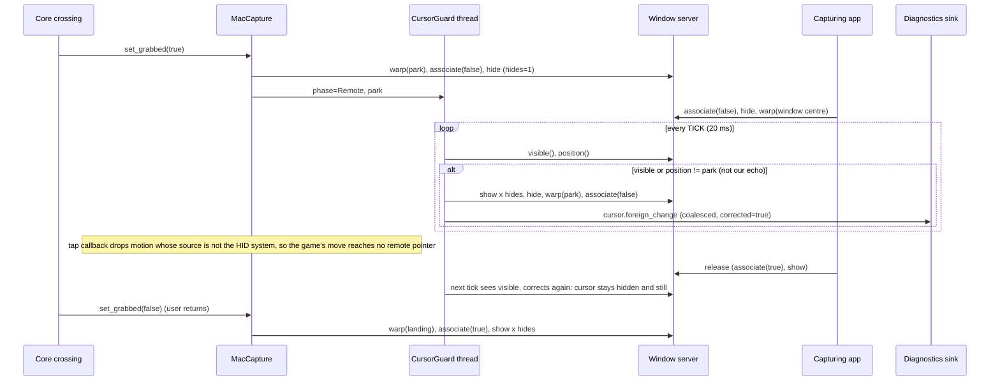
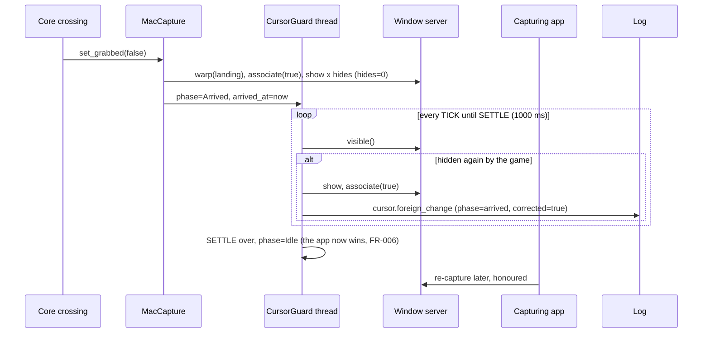

# Implementation Plan: Coexist With Apps That Capture the Mouse

**Branch**: `003-foreign-cursor-capture` | **Date**: 2026-11-17 | **Spec**: [spec.md](spec.md)

**Input**: Feature specification from `specs/003-foreign-cursor-capture/spec.md`. A bug fix inside the frozen v2 scope: no new settings, no protocol change.

## Summary

When another Mac app captures the mouse, it undoes the cursor state Mouser set once and never re-read. The plan adds a **cursor guard** to the macOS backend: while the pointer is on another computer it re-reads visibility and position every 20 ms and corrects them (re-asserting association on a slower beat); foreign motion is not forwarded; when the pointer arrives on the Mac it takes the cursor back and holds it through a 1 s settle window. A new catalog event, `cursor.foreign_change`, makes every foreign change and correction visible in the log. Research D1-D6 in [research.md](research.md); evidence in [spikes/FINDINGS.md](spikes/FINDINGS.md).

**Diagnosis status**: half confirmed. Confirmed: Mouser holds the state once (S0a), the log cannot show a foreign change (S0b), the idle baseline is clean (S0c), no recent commit changed this (S0d). Not yet observed: what a capturing app actually does (S1-S4, owner-run; probe `spikes/spike_foreign_capture.c`). The plan is built so each unobserved outcome is a constant or one function (research Risks R1-R4).

## Technical Context

**Language/Version**: Rust 1.99 (edition 2024), unchanged.

**Primary Dependencies**: `core-graphics` and `core-foundation` as already used by `mouser-platform-macos`; `CGCursorIsVisible` (deprecated, still answers; already used by the rule-10 conformance test). No new crates.

**Storage**: N/A. One new log event in the existing JSON Lines log.

**Testing**: cargo test with a scripted foreign actor on the existing `Cursor` seam; `contract_` tests for the log catalog; cargo-llvm-cov at 100% lines (the guard's thread wrapper is a few lines around a testable `tick`). Real-hardware steps are batched for the owner after the unattended run.

**Target Platform**: macOS (fix). Windows and Linux: documented limitation (D6).

**Project Type**: desktop app, Rust workspace (per-OS platform crates behind `mouser-platform`).

**Performance Goals**: restore state within 100 ms (target < 45 ms); no added forwarding latency (the guard shares no lock with the tap callback).

**Constraints**: never leave the cursor stuck hidden (Principle I): hides are counted and balanced; no panic on a refused OS call (002 V1).

**Scale/Scope**: about 50 cheap reads a second, only while grabbed or in the 1 s arrival window.

## Constitution Check

*GATE: passes before Phase 0; re-checked after Phase 1 design (below).*

| Principle | Result |
|---|---|
| I Reliability First | Pass. The guard exists to keep input in one place; balanced hides (D4), no panics (contract rule 4), recovery keys and rule 10 unchanged and re-tested (FR-008). |
| II Plain-language UI | Pass. No UI. Any user-visible Windows/Linux note is an open decision (D6), not added silently. |
| III Trusted LAN | Pass. Nothing leaves the machine; the log event carries no app or window names. |
| IV Agent-friendly | Pass. The behaviour is observable through the JSON Lines log, no new switch. |
| V Cross-platform parity | Documented limitation for Windows/Linux (D6, FR-009); the proposal to promote it to a user-visible limitation awaits the owner (Plan Summary). |
| VI Test the seams | Pass. Regression tests for both failures (FR-011) run on the `Cursor` seam with a scripted foreign actor; rule 10 re-run. |
| VII Simplicity | Pass. One new file, one new event, no trait change in the frozen `mouser-platform`. |

**Post-design re-check**: unchanged, all pass. No complexity violations, so no Complexity Tracking table.

## External dependency validation (Principle 3.1)

The macOS window server's cursor behaviour under another app's capture is outside the repository. Findings and the open items are in `spikes/FINDINGS.md`; S0 ran, S1-S4 are not run and are recorded as risks R1-R4 and surfaced in the Plan Summary. Probes: `spikes/spike_cursor_state.c` (ran), `spikes/spike_foreign_capture.c` (compile-checked only, owner-run).

## Package boundary and gap analysis (Principles 3.2, 3.3)

| Story | Packages touched | Kind |
|---|---|---|
| 1 | `mouser-platform-macos`, `mouser-app` (sink wiring) | multi-package |
| 2 | `mouser-platform-macos` | package-local |
| 3 | `mouser-platform-macos`, `mouser-app`, log catalog contract | multi-package |

Contracts fixed before any task uses them: `contracts/macos-cursor-guard.md` (the `Cursor` trait additions, timing constants, behavioural rules) and `contracts/log-events-delta.md` (event row and schema). The frozen `mouser-platform` trait is untouched.

**Package pass** (code read, not recalled):
- `mouser-platform-macos`: `capture.rs` 354-370 holds state once (HIGH, confirmed by reading); `Cursor::associate/hide/show` are infallible and `expect` on OS refusal (`capture.rs` 116-130), and `allow_hiding_in_background` `assert_eq!`s (164), which would panic inside a guard thread (HIGH, confirmed); `stop()` ends with `.unwrap()` on `set_grabbed(false)` (382, MEDIUM, confirmed); `handle()` forwards every non-Mouser motion event while grabbed (`capture.rs` 287-307, HIGH, confirmed for source-agnostic forwarding; whether foreign events reach it is suspected, S2).
- `mouser-app`: `diagnostics.rs` is typed to the Windows crate's `Diagnostics` sink; the macOS sink needs a shared or parallel type (MEDIUM, confirmed by reading line 8).
- Log catalog: closed schema, new event needs the schema and both contract tests (LOW, confirmed).

**Seam pass**: the app-to-backend sink seam is the only contract between the two packages; the producing side (macOS guard) writes `cursor.foreign_change` with the closed field set, the consuming side (app sink to `log.write`) accepts any catalog name with typed fields, as for Windows (checked in `diagnostics.rs`). No mismatch.

**Coverage critic**: union covers `mouser-platform-macos`, `mouser-app` and the catalog contract.

## Execution mode (Principle 3.6)

**Standard.** Fast pass does not qualify: there is a contract change (catalog event, `Cursor` trait), more than three production files change, and the defect's suspected cause is only half reproduced. Package-parallel is not warranted: two packages, one lane of real work. Task shape: Setup, Foundational, one phase per story in order (1, 2, 3), Polish.

## Sequence diagrams (Principle 3.5)

### Story 1: a game captures while the pointer is on the other computer



### Story 2: the pointer arrives on the Mac while a game holds the mouse



### Story 3: recovery keys and the log

```mermaid
sequenceDiagram
    participant User
    participant Core as Core (panic / QuickJump)
    participant Cap as MacCapture
    participant Guard as CursorGuard thread
    participant Log as Diagnostics sink
    Note over Cap,Guard: a capture has disagreed with Mouser's state
    Guard->>Log: cursor.foreign_change {aspect, phase, corrected, count}
    User->>Core: Ctrl+Alt+Shift+J or Escape x2
    Core->>Cap: set_grabbed(false) or set_grabbed(true) per target computer
    Cap->>Cap: ungrab: associate(true), show x hides; or grab: park, associate(false), hide once
    Cap->>Guard: phase=Arrived or Remote
    Note over Guard: the cursor is visible only on the computer that has the pointer, and the log line says what happened
```

## Technical debt survey (Principle 3.8)

Files surveyed: `capture.rs`, `echo.rs`, `tap.rs`, `lib.rs` (macOS), `apps/mouser-app/src/diagnostics.rs`.

1. **Suppression directives**: grep for coverage-ignore, `allow(`, `#[ignore]` in the touched files found none (`coverage(off)`, `allow(`, `#[ignore`, `LCOV_EXCL`, TODO, FIXME all absent from `capture.rs`, `echo.rs`, `tap.rs`, `lib.rs` and `diagnostics.rs`).
2. **Local debt** (tasks T-debt-1 to 3):
   - `Cursor::associate/hide/show` panic on refusal and `allow_hiding_in_background` asserts: change to `Result` (contract), remove the `expect`s; `stop()`'s `.unwrap()` becomes a logged ignore (it cannot return an error from `Drop`).
   - `grabbed` is held twice (`MacCapture.grabbed` and `State.grabbed`): the guard needs a single source; keep the `AtomicBool` in `State` and delete the field.
   - `capture.rs` (389 lines) mixes event translation, the cursor seam and the capture type; the guard goes in a new `cursor_guard.rs` rather than growing it, and `Cursor` plus `SystemCursor` move to `cursor.rs` (behaviour-preserving; the private SkyLight call comes with them).
3. **Structural debt**: the existing `Echo` (position/time ring) already answers "is this my own move?" and is reused for FR-004, so no second echo mechanism is built. Windows `diag.rs` defines the sink types; they are moved to `mouser-platform` (types only) so the macOS sink and the app share one definition, removing the app's Windows-typed `diagnostics.rs` coupling. If that move proves to touch the frozen crate's trait surface, fall back to a duplicate small type in the macOS crate and record it.

## Project Structure

### Documentation (this feature)

```text
specs/003-foreign-cursor-capture/
├── plan.md
├── research.md
├── data-model.md
├── quickstart.md
├── contracts/
│   ├── log-events-delta.md
│   └── macos-cursor-guard.md
├── spikes/
│   ├── FINDINGS.md
│   ├── spike_cursor_state.c / .out
│   └── spike_foreign_capture.c
└── tasks.md             # /speckit-tasks, not created here
```

### Source Code

```text
crates/mouser-platform-macos/src/
├── cursor.rs            # NEW: Cursor trait (+visible, fallible calls) and SystemCursor, moved from capture.rs
├── cursor_guard.rs      # NEW: Expectation, Observation, decide(), tick(), guard thread, coalesced log
├── capture.rs           # MacCapture drives the guard; handle() filters foreign-source motion
├── diag.rs              # NEW: macOS diagnostics sink (or the shared type, see debt survey)
└── *_tests.rs           # scripted foreign-actor tests
apps/mouser-app/src/diagnostics.rs   # wire the macOS sink to the log
specs/002-mouser-v2/contracts/log-events.md + log-events.schema.json   # add cursor.foreign_change
docs/troubleshooting.md, docs/technical-decisions.md   # Polish: limitation and design note
```

**Structure Decision**: all behaviour in the macOS backend behind the existing `InputCapture` seam; the log catalog is the only shared contract.

## Acceptance and contract infrastructure (Principle 3.4)

Present and working: cargo test, `acc_` cucumber and `contract_` conventions, cargo-llvm-cov at 100%, the platform conformance rules, the `Cursor` test seam. Missing: nothing. A real-window-server test cannot run unattended (it moves the live cursor), so it is the owner batch in quickstart section 3, not a gate.

## Risks, decisions awaiting the owner

- R1-R4 (research.md): unobserved until S1-S4 are run with `spike_foreign_capture`.
- D3: the 1 s settle window is an interpretation of FR-005's "keep that state if the game tries to re-capture"; unbounded holding would make a game on the Mac unusable.
- D6: Windows/Linux get a documented, not user-visible, limitation unless the owner sees the bug there.

## Complexity Tracking

No violations to justify.
